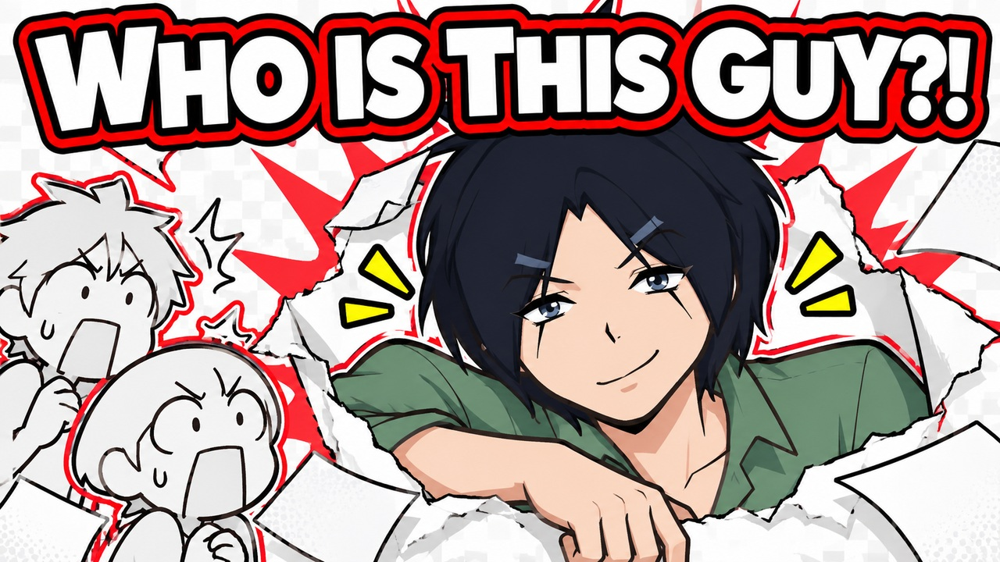
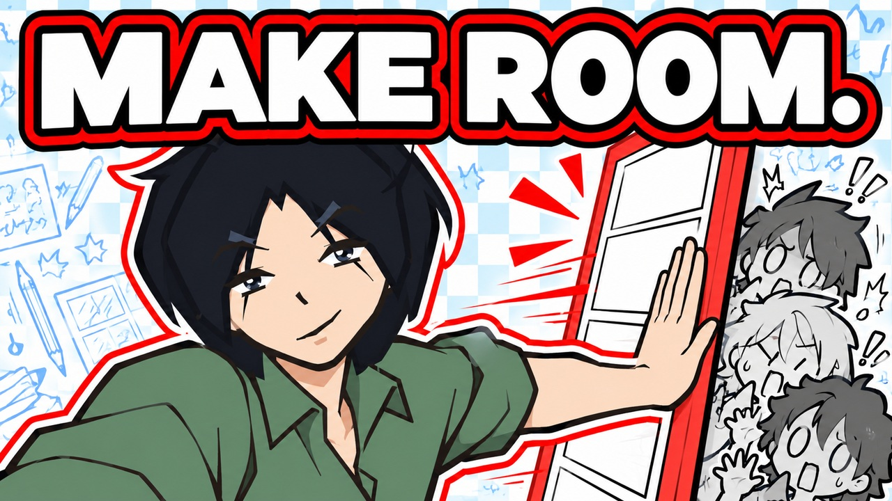

# ADB thumbnail concepts

Recommended: **MAKE ROOM.** (`concept_b_hand_r2`). Proposed video title: **Storytime Animators, I'm Coming for Your Watch Time**. Native1672×941 PNG and1280×720 upload JPG are at the thumbnail root. This is an assistant recommendation; no user selection/approval is invented.

## WHO IS THIS GUY?!

[Native PNG](revisions/concept_a/thumbnail.png) · [Prompt](revisions/concept_a/PROMPT.md) · [Review](revisions/concept_a/REVIEW.md)

## MAKE ROOM.

[Native PNG](revisions/concept_b/thumbnail.png) · [Prompt](revisions/concept_b/PROMPT.md) · [Review](revisions/concept_b/REVIEW.md)

Both concepts are original AI-generated illustrations. Full and mobile views were inspected; no live upload or CTR result is claimed. Candidates stay outside the user-approved collection index until the user chooses.

## MAKE ROOM. — refined hand

The recommended upload uses the targeted five-digit hand refinement. Original B stays preserved. [Prompt](revisions/concept_b_hand_r2/PROMPT.md).
