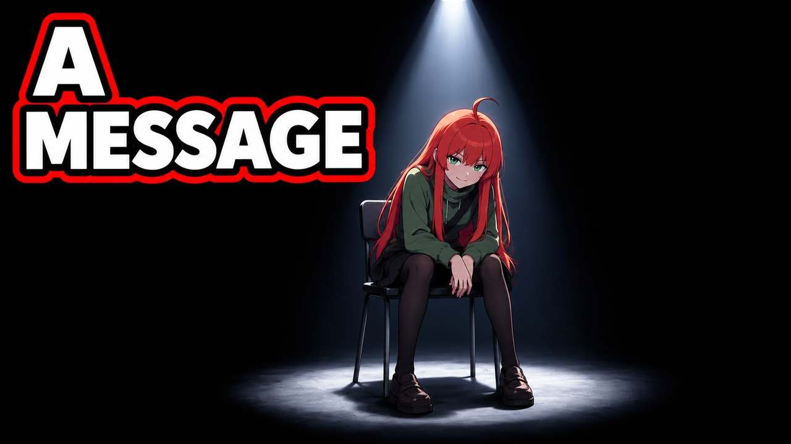
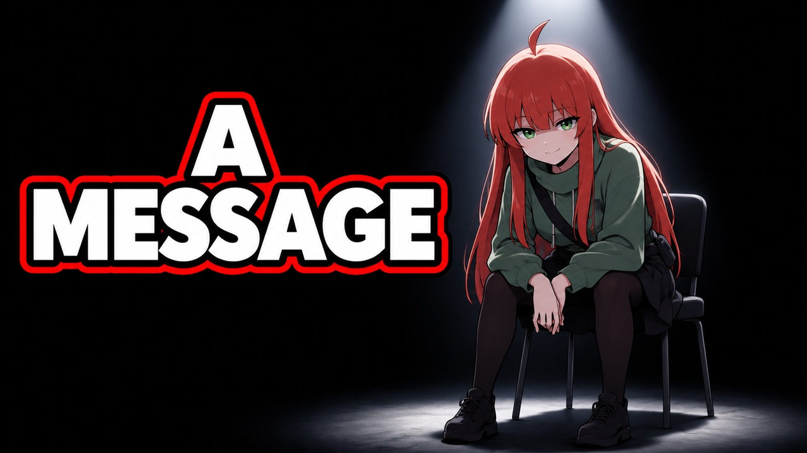

# Nemi — black void and one spotlight

Latest pair follows the supplied empty-space/chair/overhead-light example. All previous options are preserved; no image is marked selected.

## A — Full seated figure under one spotlight

[Native PNG](revisions/black_void_spotlight_a/thumbnail.png) · [Upload JPG](revisions/black_void_spotlight_a/thumbnail.jpg) · [Exact prompt](revisions/black_void_spotlight_a/PROMPT.md) · [QA](revisions/black_void_spotlight_a/QA.json)

## B — Closer forward address in black void

[Native PNG](revisions/black_void_spotlight_b/thumbnail.png) · [Upload JPG](revisions/black_void_spotlight_b/thumbnail.jpg) · [Exact prompt](revisions/black_void_spotlight_b/PROMPT.md) · [QA](revisions/black_void_spotlight_b/QA.json)

Built-in image generation; native1672×941, upload1280×720. [Independent review](review/BLACK_VOID_INDEPENDENT_REVIEW.md). Prior sets are in [all concepts](CONCEPTS.md).
