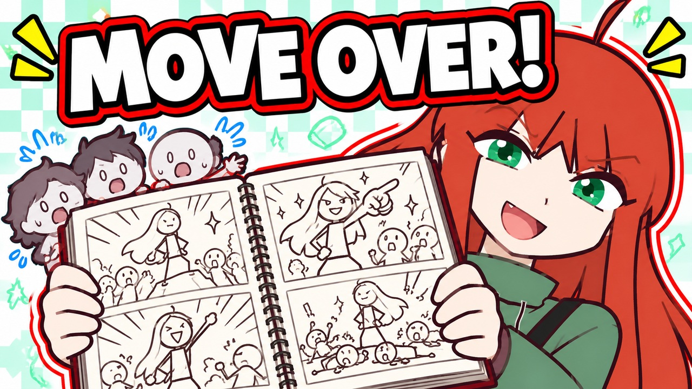
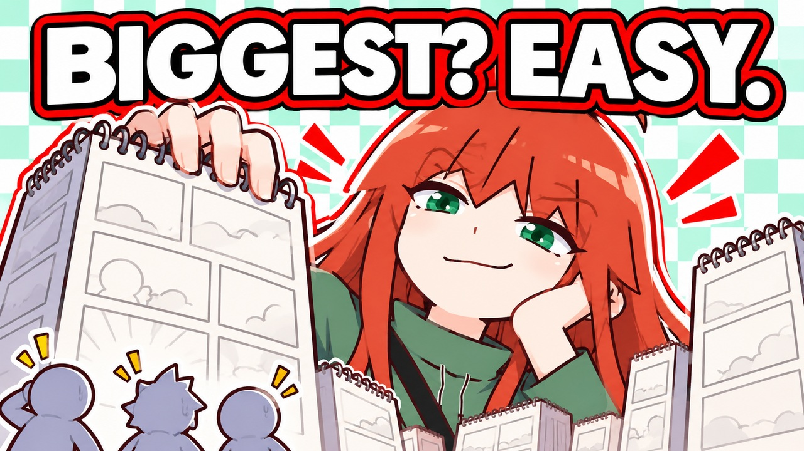

# NEMI thumbnail concepts

Recommended: **MOVE OVER!** (`concept_a`). Proposed video title: **A Message to Every Storytime Animator**. Native1672×941 PNG and1280×720 upload JPG are at the thumbnail root. This is an assistant recommendation; no user selection/approval is invented.

## MOVE OVER!

[Native PNG](revisions/concept_a/thumbnail.png) · [Prompt](revisions/concept_a/PROMPT.md) · [Review](revisions/concept_a/REVIEW.md)

## BIGGEST? EASY.

[Native PNG](revisions/concept_b/thumbnail.png) · [Prompt](revisions/concept_b/PROMPT.md) · [Review](revisions/concept_b/REVIEW.md)

Both concepts are original AI-generated illustrations. Full and mobile views were inspected; no live upload or CTR result is claimed. Candidates stay outside the user-approved collection index until the user chooses.
