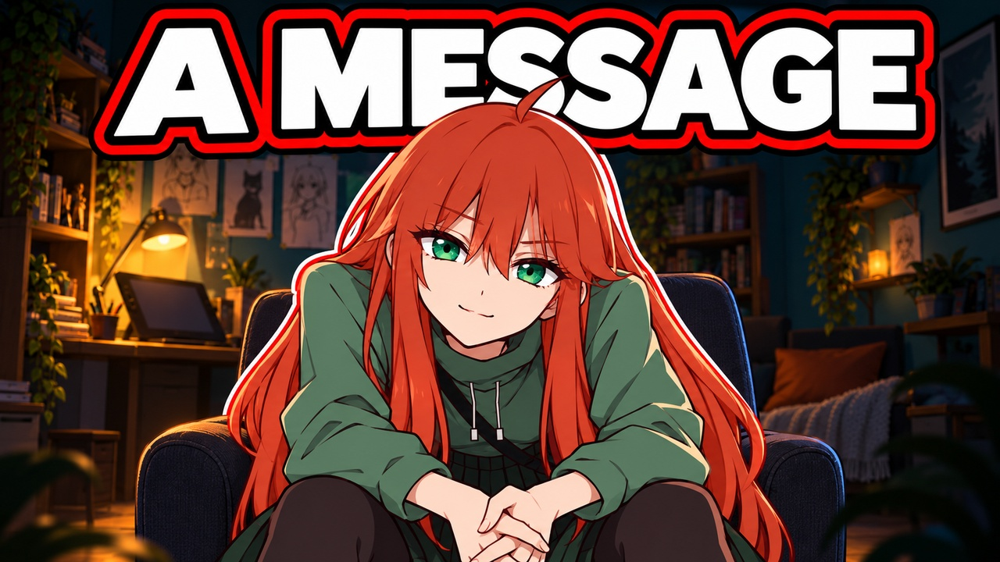
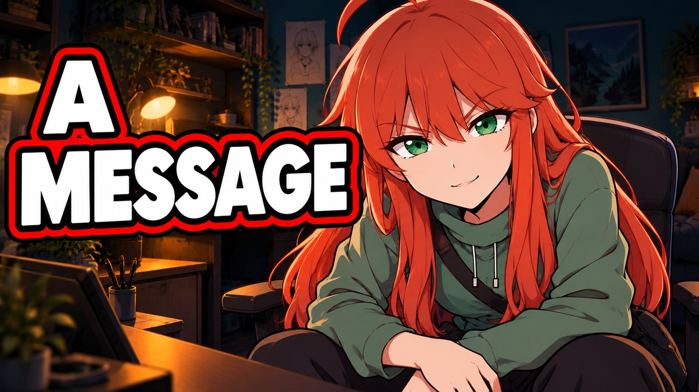
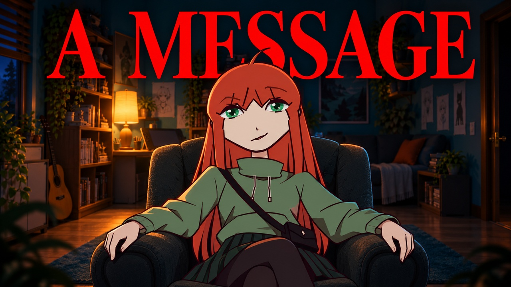
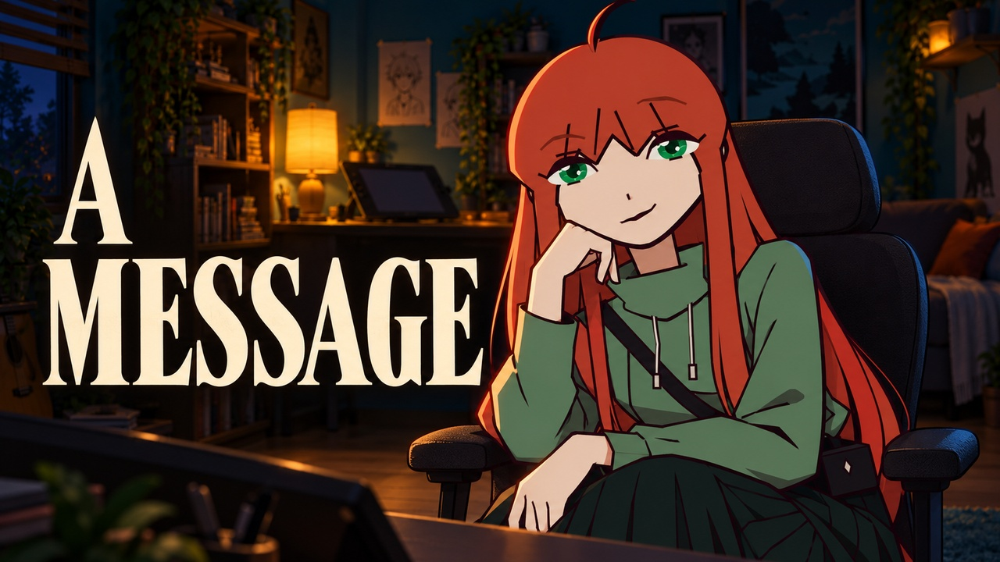

# Additional Nemi set — illustrated forward lean

Nemi’s established episode-thumbnail illustration and bold WHITE/BLACK/RED/BLACK lettering, in the dark room. Previous options are kept below and unchanged. No selection is inferred.

## New A — Front-of-chair forward lean

[Native PNG](revisions/illustrated_dark_forward_a/thumbnail.png) · [Upload JPG](revisions/illustrated_dark_forward_a/thumbnail.jpg) · [Prompt](revisions/illustrated_dark_forward_a/PROMPT.md) · [QA](revisions/illustrated_dark_forward_a/QA.json)

## New B — Angled forward lean close-up

[Native PNG](revisions/illustrated_dark_forward_b/thumbnail.png) · [Upload JPG](revisions/illustrated_dark_forward_b/thumbnail.jpg) · [Prompt](revisions/illustrated_dark_forward_b/PROMPT.md) · [QA](revisions/illustrated_dark_forward_b/QA.json)

---

# NEMI — A MESSAGE

Two current dark-room seated concepts, made from the user’s correction. Neither is marked as user-selected.

## A — Frontal armchair announcement

[Native PNG](revisions/dark_message_a/thumbnail.png) · [Upload JPG](revisions/dark_message_a/thumbnail.jpg) · [Prompt](revisions/dark_message_a/PROMPT.md) · [QA](revisions/dark_message_a/QA.json)

## B — Angled chair close-up

[Native PNG](revisions/dark_message_b/thumbnail.png) · [Upload JPG](revisions/dark_message_b/thumbnail.jpg) · [Prompt](revisions/dark_message_b/PROMPT.md) · [QA](revisions/dark_message_b/QA.json)

[Full/mobile review](REVIEW.md). Earlier bright deliveries remain preserved under `rejected_bright_round1/`; they are user-rejected and are not current options.
