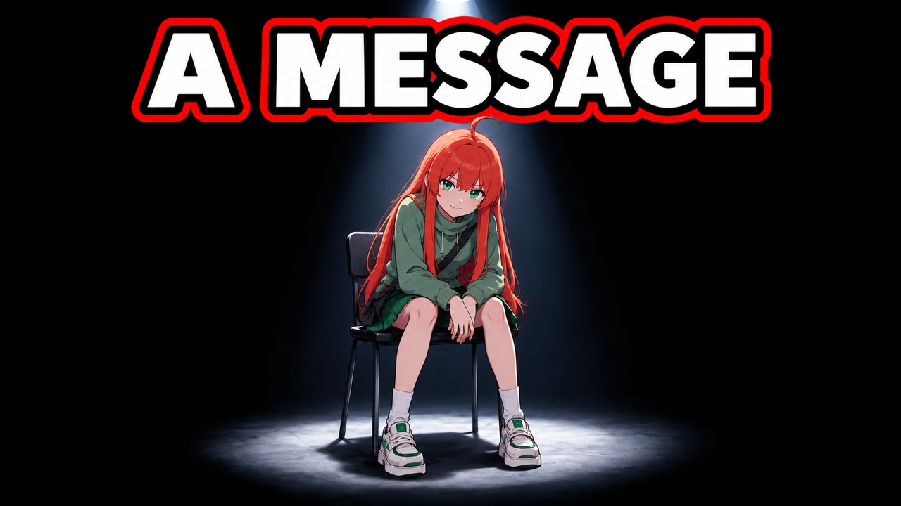
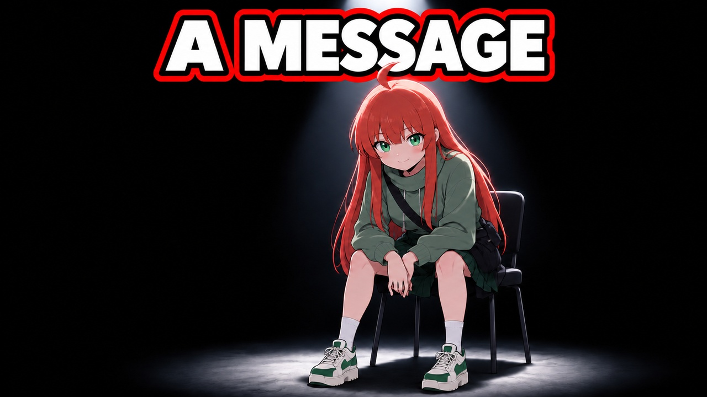

# Nemi — corrected identity and top-centred title

Latest corrected pair keeps the empty black space, single spotlight, chair and forward lean. Outfit is matched to Nemi’s canonical full-body reference and face direction to EP13; A MESSAGE is one top-centred line. Prior images remain preserved; no candidate is marked user-selected.

## A — Corrected Nemi — full spotlight

[Native PNG](revisions/black_void_identity_r2_a/thumbnail.png) · [Upload JPG](revisions/black_void_identity_r2_a/thumbnail.jpg) · [Prompt](revisions/black_void_identity_r2_a/PROMPT.md) · [QA](revisions/black_void_identity_r2_a/QA.json)

## B — Corrected Nemi — closer spotlight

[Native PNG](revisions/black_void_identity_r2_b/thumbnail.png) · [Upload JPG](revisions/black_void_identity_r2_b/thumbnail.jpg) · [Prompt](revisions/black_void_identity_r2_b/PROMPT.md) · [QA](revisions/black_void_identity_r2_b/QA.json)

[Reference audit](review/IDENTITY_R2_REFERENCE_AUDIT.md) · [Independent review](review/IDENTITY_R2_INDEPENDENT_REVIEW.md). Built-in image generation, native1672×941 and upload1280×720.
